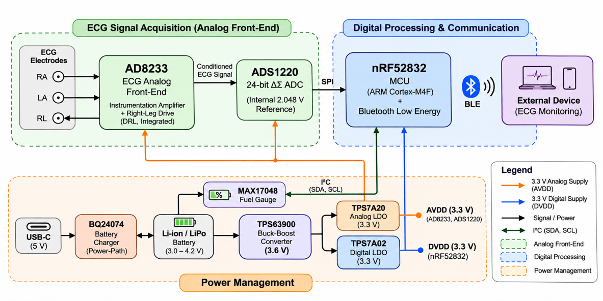
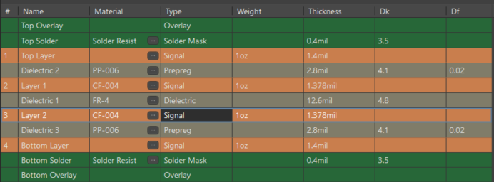
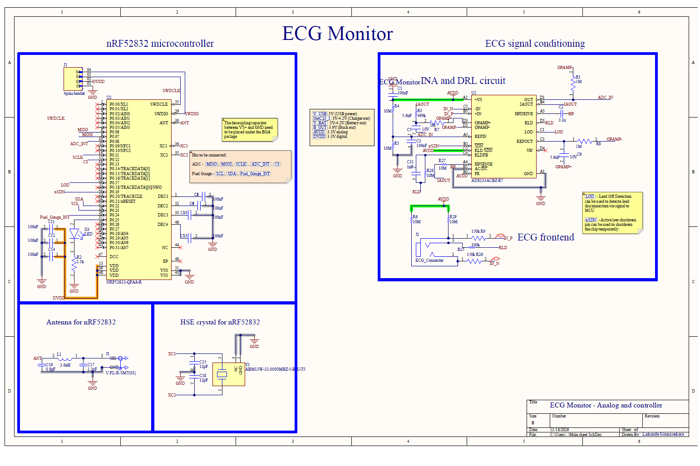
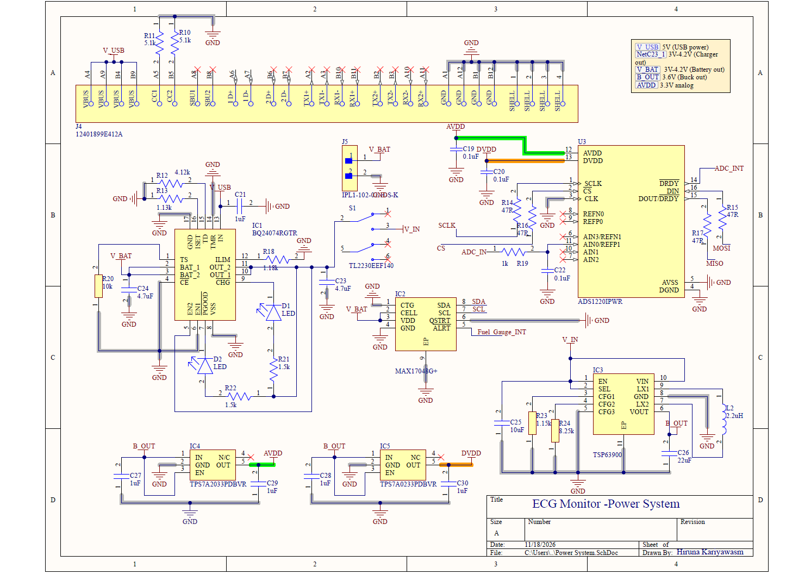
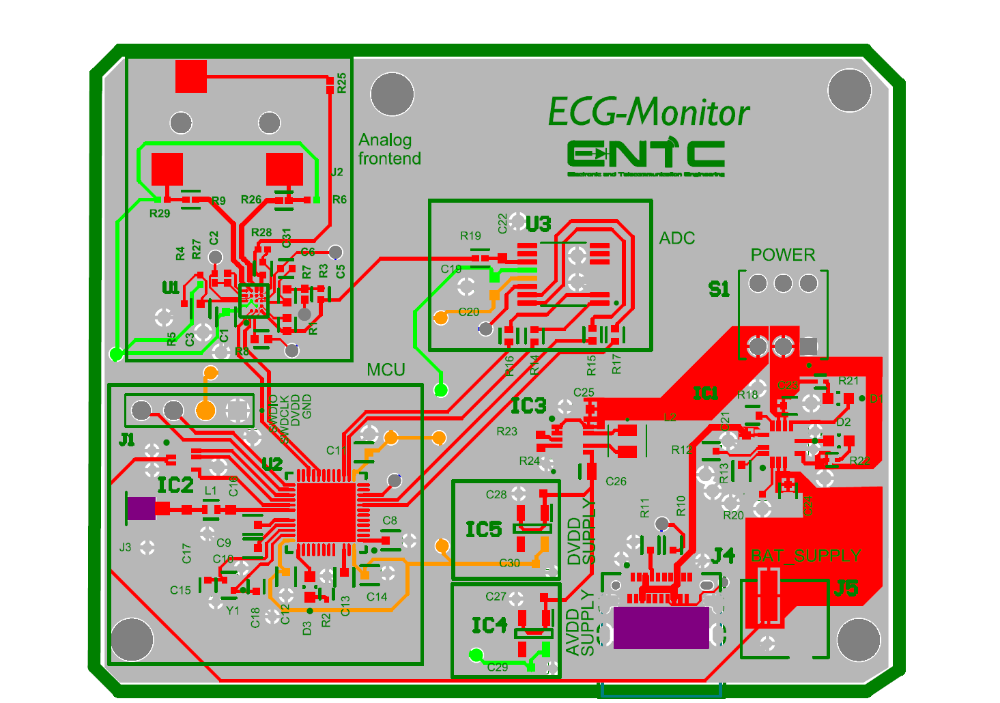
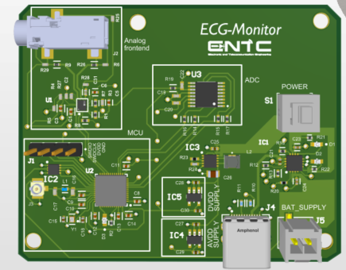
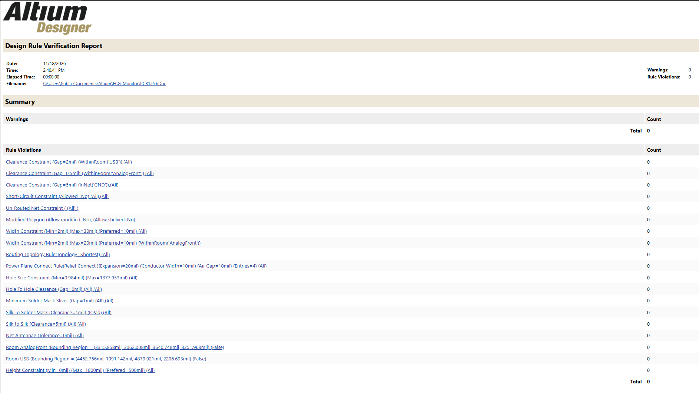

# PCB design for a wearable ECG Signal Acquisition Device

A four-layer wearable ECG acquisition PCB 

The device is designed to acquire low-amplitude ECG signals from
external electrodes, condition and digitize the signal, and transmit
measurements wirelessly over Bluetooth Low Energy (BLE).


------------------------------------------------------------------------

## 1. System Overview

The design is organized into three main functional sections:

-   **ECG signal acquisition:** The AD8233 analog front-end (AFE)
    receives the electrode signals and performs initial amplification
    and signal conditioning.
-   **Data conversion and wireless communication:** The ADS1220 24-bit
    delta-sigma ADC digitizes the conditioned signal. The nRF52832
    micro-controller interfaces with the ADC over SPI and sends acquired
    measurements to an external device using BLE.
-   **Power management:** A rechargeable single-cell Li-ion/LiPo battery
    supplies the board. Charging, battery monitoring, voltage
    conversion, and separate analog and digital regulation are provided
    on the PCB.

### Overall block diagram



*Figure 1. Overall system block diagram.*

## 2. Hardware Architecture

  -----------------------------------------------------------------------
  Functional block        Main component          Purpose
  ----------------------- ----------------------- -----------------------
  ECG analog front-end    AD8233                  ECG signal
                                                  amplification and
                                                  conditioning; includes
                                                  instrumentation
                                                  amplifier, reference
                                                  buffer, and right-leg
                                                  drive amplifier

  Analog-to-digital       ADS1220                 24-bit delta-sigma
  conversion                                      conversion with
                                                  integrated programmable
                                                  gain amplifier (PGA)

  Main controller and BLE nRF52832                Controls acquisition,
                                                  processes measurements,
                                                  and provides BLE
                                                  connectivity

  Battery charger / power BQ24074                 Single-cell Li-ion/LiPo
  path                                            charging and power-path
                                                  management

  Buck-boost regulation   TPS63900                Regulates the battery
                                                  supply to 3.6 V

  Analog LDO              TPS7A20                 Generates a 3.3 V
                                                  analog supply (AVDD)

  Digital LDO             TPS7A02                 Generates a 3.3 V
                                                  digital supply (DVDD)

  Battery fuel gauge      MAX17048                Estimates battery state
                                                  of charge and
                                                  communicates with the
                                                  MCU over I²C
  -----------------------------------------------------------------------

### Signal acquisition path

1.  ECG electrodes connect to the AD8233 analog front-end.
2.  The AD8233 conditions the low-amplitude ECG signal.
3.  The ADS1220 digitizes the conditioned signal using its internal
    2.048 V reference.
4.  The nRF52832 receives ADC measurements over SPI.
5.  The microcontroller can transmit the acquired measurements to an
    external monitoring device using BLE.

### Power path

The power architecture described in the design report is:

``` text
USB-C (5 V)
    |
  BQ24074  <---->  Li-ion/LiPo battery
                       |
                    TPS63900
                  Buck-boost
                    (3.6 V)
                       |
             +---------+---------+
             |                   |
          TPS7A20              TPS7A02
           (3.3 V)              (3.3 V)
             |                   |
       Analog supply        Digital supply
          (AVDD)                (DVDD)
```

The analog supply powers the AD8233 and ADS1220, while the digital
supply powers the nRF52832 and associated digital circuitry. The
MAX17048 monitors the battery through an I²C connection.

## 3. PCB Design Considerations

### Component placement

The placement strategy aims to reduce noise coupling into the sensitive
ECG input circuitry:

-   The AD8233, ADS1220, and related analog components are grouped
    together to keep sensitive analog traces short.
-   The nRF52832 and digital circuitry are placed away from the analog
    input section.
-   The TPS63900 switching converter and its inductor are kept away from
    ECG signal paths.
-   Decoupling capacitors are placed close to the relevant IC power
    pins.

### Layer stack-up

The PCB uses a four-layer stack-up:

  Layer               Assignment
  ------------------- ----------------------------------------
  Layer 1 -- Top      Component placement and signal routing
  Layer 2 -- Inner    Ground plane
  Layer 3 -- Inner    Ground plane
  Layer 4 -- Bottom   Signal routing

The two internal ground layers provide low-impedance return paths and
support signal integrity.



*Figure 2. Four-layer PCB stack configuration.*

### Grounding strategy

A common, continuous ground plane is used for the analog and digital
sections. The analog and digital components are arranged in separate
physical regions, but their grounds are not split into isolated planes.
This approach is intended to avoid the undesirable return-current paths
and additional ground impedance that can result from splitting the
ground plane.

Short signal traces, suitable decoupling, careful placement, and
continuous ground return paths are used to help limit interference.

## 4. PCB Design Images

The following images are intended to document the schematic, layout, and
3D implementation. Add the corresponding exported images to the `media/`
directory using the filenames shown.

### 4.1 Main PCB schematic



*Figure 3. Main PCB schematic, including the nRF52832 controller and ECG
signal-conditioning circuitry.*

### 4.2 Power-system schematic



*Figure 4. Power-system schematic.*

### 4.3 PCB layout



*Figure 5. PCB layout.*

### 4.4 3D PCB view



*Figure 6. Three-dimensional PCB view.*


### 4.5 Design Rule Check



*Figure 7. Altium Designer Design Rule Check (DRC) report.


## 5. Tools and Design Environment

-   **PCB design:** Altium Designer
-   **Board architecture:** Four-layer PCB
-   **Main controller:** Nordic Semiconductor nRF52832
-   **ECG AFE:** Analog Devices AD8233
-   **ADC:** Texas Instruments ADS1220

## 6. Contributors

-   **J. H. D. Kariyawasam** --- 230318M
-   **L. U. A. Gunasekara** --- 230212H

------------------------------------------------------------------------

## Disclaimer

This project is an academic PCB design exercise. It is not represented
as a certified medical device and should not be used for diagnosis,
treatment, or clinical decision-making. Any physical implementation
would require appropriate electrical safety, performance, and regulatory
verification before use with a person.
